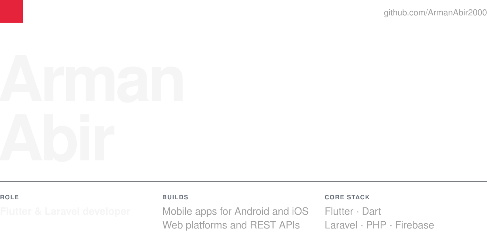
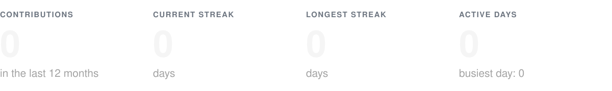
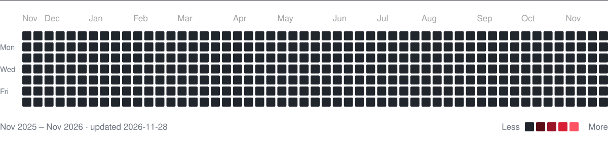

<picture>
  <source media="(prefers-color-scheme: dark)" srcset="assets/header-dark.svg" />
  <source media="(prefers-color-scheme: light)" srcset="assets/header-light.svg" />
  
</picture>

  
  
  

## About

I build mobile and web applications end to end: Flutter on the client, Laravel and Firebase on the server, and the APIs in between. I care about clean architecture, readable code and products that hold up after launch.

- **Mobile** — Flutter and Dart, cross-platform apps for Android and iOS
- **Backend** — Laravel and PHP, REST APIs, Firebase services
- **Data** — PostgreSQL, MySQL, Firestore
- **Practice** — Clean Architecture, maintainable project structure, AI-assisted workflows

## Stack

<table>
  <tr>
    <td width="120"><b>MOBILE</b></td>
    <td>
      <picture>
        <source media="(prefers-color-scheme: light)" srcset="https://skillicons.dev/icons?i=flutter,dart,androidstudio&theme=light" />
        
      </picture>
    </td>
  </tr>
  <tr>
    <td><b>BACKEND</b></td>
    <td>
      <picture>
        <source media="(prefers-color-scheme: light)" srcset="https://skillicons.dev/icons?i=laravel,php,firebase,python&theme=light" />
        
      </picture>
    </td>
  </tr>
  <tr>
    <td><b>DATA</b></td>
    <td>
      <picture>
        <source media="(prefers-color-scheme: light)" srcset="https://skillicons.dev/icons?i=postgres,mysql&theme=light" />
        
      </picture>
    </td>
  </tr>
  <tr>
    <td><b>TOOLING</b></td>
    <td>
      <picture>
        <source media="(prefers-color-scheme: light)" srcset="https://skillicons.dev/icons?i=git,github,linux,vscode&theme=light" />
        
      </picture>
    </td>
  </tr>
</table>

## Activity

<picture>
  <source media="(prefers-color-scheme: dark)" srcset="https://raw.githubusercontent.com/ArmanAbir2000/ArmanAbir2000/output/stats-dark.svg" />
  <source media="(prefers-color-scheme: light)" srcset="https://raw.githubusercontent.com/ArmanAbir2000/ArmanAbir2000/output/stats-light.svg" />
  
</picture>

<picture>
  <source media="(prefers-color-scheme: dark)" srcset="https://raw.githubusercontent.com/ArmanAbir2000/ArmanAbir2000/output/activity-dark.svg" />
  <source media="(prefers-color-scheme: light)" srcset="https://raw.githubusercontent.com/ArmanAbir2000/ArmanAbir2000/output/activity-light.svg" />
  
</picture>

Cards are rendered every 6 hours by <a href=".github/workflows/profile-cards.yml">a workflow in this repo</a> from the GitHub API.

## Projects

| Project | Stack | Notes |
| :-- | :-- | :-- |
| [**lan-party**](https://github.com/ArmanAbir2000/lan-party) | GDScript · Godot | Public, archived |

More projects will be listed here as their demos and docs are ready.

---

  <b>ARMAN ABIR</b> &nbsp;·&nbsp; Build. Ship. Iterate.

